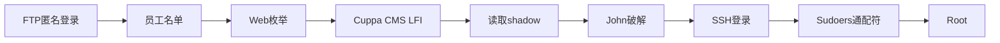

---
tags:
  - wargame
  - comparison
  - dc1
  - w1r3s
  - privilege-escalation
created: 2026-09-10
modified: 2026-09-10
related: "[[W1R3S 1.0.1 详细渗透笔记]]"
---

# DC-1 vs W1R3S 靶机攻击对比分析

> [!info] 分析目的
> 通过对比两个Easy难度的靶机，理解不同攻击路径的设计差异，学习提权技巧。

---

## 基本信息对比

| 项目 | DC-1 (LupinOne) | W1R3S 1.0.1 |
|------|-----------------|-------------|
| **作者** | DLyezus | SpecterWires |
| **难度** | Easy | Beginner/Intermediate |
| **OS** | Debian Linux | Ubuntu 18.04 |
| **开放端口** | 22(SSH), 80(HTTP) | 21(FTP), 22(SSH), 80(HTTP), 3306(MySQL) |
| **核心漏洞** | webbrowser.py权限777 | Cuppa CMS LFI + Sudoers通配符 |
| **Flag位置** | /home/icex64/user.txt, /root/root.txt | /root/flag.txt |
| **视频来源** | 红队笔记 - LupinOne专题 | 红队笔记 - W1R3S 1.0.1专题 |

---

## 攻击链对比

### DC-1 攻击链


**关键步骤**：
1. 发现`/~secret`隐藏目录
2. Base58编码的SSH私钥
3. 使用fasttrack字典破解passphrase
4. SSH登录icex64
5. webbrowser.py权限777 → 劫持
6. 获得arsene用户密码（.secret文件）
7. **sudo -l 发现arsene可sudo pip**
8. pip install执行恶意setup.py → root

### W1R3S 攻击链



**关键步骤**：
1. FTP匿名登录获取员工信息
2. robots.txt暗示`/administrator`路径
3. 发现Cuppa CMS管理后台
4. LFI漏洞读取/etc/shadow
5. SHA-512 hash用John破解
6. SSH登录w1r3s
7. `sudo -l`发现`(ALL) NOPASSWD: ALL`
8. 直接`sudo su -`获得root

---

## 关键技术点对比

| 技术点 | DC-1 | W1R3S | 学习价值 |
|--------|------|-------|---------|
| **信息收集入口** | Web目录枚举 | FTP匿名登录 | FTP常被忽视 |
| **编码识别** | Base58 vs Base64 | Base64倒序文本 | 编码技巧 |
| **密码破解** | SSH私钥passphrase | Shadow文件hash | 不同场景 |
| **Web漏洞** | Python库劫持 | LFI文件包含 | 漏洞类型多样 |
| **提权方式** | 双重sudo（两步） | 单次sudo（一步） | Sudo配置审计 |
| **GTFOBins应用** | pip install | sudo su | 常用提权工具 |

---

## 核心差异分析

### 1. 入口点选择

**DC-1**：
- 通过robots.txt的`Disallow: /~myfiles`诱饵
- 引导攻击者发现`/~secret`真实路径
- 考察目录枚举能力

**W1R3S**：
- FTP匿名登录是明显入口
- robots.txt直接暴露`/administrator`
- 更直接的Web应用发现

### 2. 漏洞利用复杂度

**DC-1**：
```
webbrowser.py劫持 → arsene用户 → pip安装恶意包 → root
```
- 需要理解Python导入机制
- 需要两层sudo权限叠加
- 提权链条较长

**W1R3S**：
```
LFI读取shadow → John破解 → SSH登录 → sudo -l发现ALL → root
```
- 经典的LFI利用路径
- Sudo配置错误一次性解决
- 更适合初学者理解

### 3. 提权设计意图

**DC-1**：
- 设计目的是教学"双重sudo叠加"概念
- icex64只能运行heist.py作为arsene
- arsene只能运行pip作为root
- 考验对sudoers配置的深入理解

**W1R3S**：
- 设计目的是展示"Sudoers通配符"的危险性
- `(ALL) NOPASSWD: ALL`是最常见的配置错误
- 一步到位的提权设计

---

## DC-1未完成根因分析

> [!warning] 关键发现
> 我在DC-1攻击中遗漏了第二步sudo检查，导致未能获得root flag。

**我的攻击过程**：
1. ✅ 发现webbrowser.py权限777
2. ✅ 劫持webbrowser.py获得arsene用户
3. ❌ **遗漏**：arsene用户执行`sudo -l`会显示`(root) NOPASSWD: /usr/bin/pip`
4. ❌ **遗漏**：通过pip install执行恶意setup.py提权到root

**攻略中的正确路径**：
```bash
# 第一次sudo检查（icex64）
sudo -l
# (arsene) NOPASSWD: /usr/bin/python3.9 /home/arsene/heist.py

# webbrowser.py劫持后切换到arsene
su - arsene
# 密码: rQ8EE"UK,eV)weg~*nd-`5:{*`j7*Q

# 第二次sudo检查（arsene）⚠️ 我遗漏了这一步
sudo -l
# (root) NOPASSWD: /usr/bin/pip

# pip提权到root
TF=$(mktemp -d)
echo 'import os; os.execl("/bin/bash", "bash")' > $TF/setup.py
sudo pip install $TF
whoami  # root
```

---

## 学习建议

### 对于DC-1
1. 理解双重sudo叠加的概念
2. 每次切换用户后都要执行`sudo -l`
3. GTFOBins是提权必备工具
4. Python标准库被可写时的风险

### 对于W1R3S
1. 不要忽视FTP匿名登录
2. Cuppa CMS LFI漏洞的典型利用
3. SHA-512 hash的John破解方法
4. Sudoers通配符的危险性

---

## 攻击技巧总结

### 通用技巧
1. **全端口扫描**：`nmap -p-`发现隐藏服务
2. **服务版本识别**：`-sV`比端口扫描更重要
3. **目录枚举**：gobuster/ffuf是必备工具
4. **Sudo检查**：每次切换用户都要执行`sudo -l`
5. **GTFOBins**：`gtfobins.github.io`查询可提权命令

### FTP相关
1. 匿名登录尝试：用户名anonymous/ftp，密码空
2. 下载所有文件进行关键词搜索
3. 注意文件名编码（倒序、Base64等）

### Web相关
1. robots.txt是信息泄露源
2. CMS管理后台常见默认路径
3. LFI漏洞利用需要目录遍历序列
4. POST参数也可能存在注入

### 提权相关
1. `sudo -l`必须执行，且每次切换用户后都要检查
2. `(ALL) NOPASSWD: ALL`是最危险的配置
3. 检查SUID二进制：`find / -perm -4000`
4. GTFOBins查询命令利用方法

---

## 知识关联

- [[W1R3S 1.0.1 详细渗透笔记]] - W1R3S完整攻击步骤
- [[DC-1/LupinOne]] - DC-1攻略（待补充）
- [[GTFOBins]] - 提权命令查询
- [[Cuppa CMS]] - Web漏洞案例
- [[Sudoers配置]] - Linux权限管理

---

*对比分析基于红队笔记B站视频整理*
*DC-1攻略来源：dc-writeups.md + GitHub writeup*
